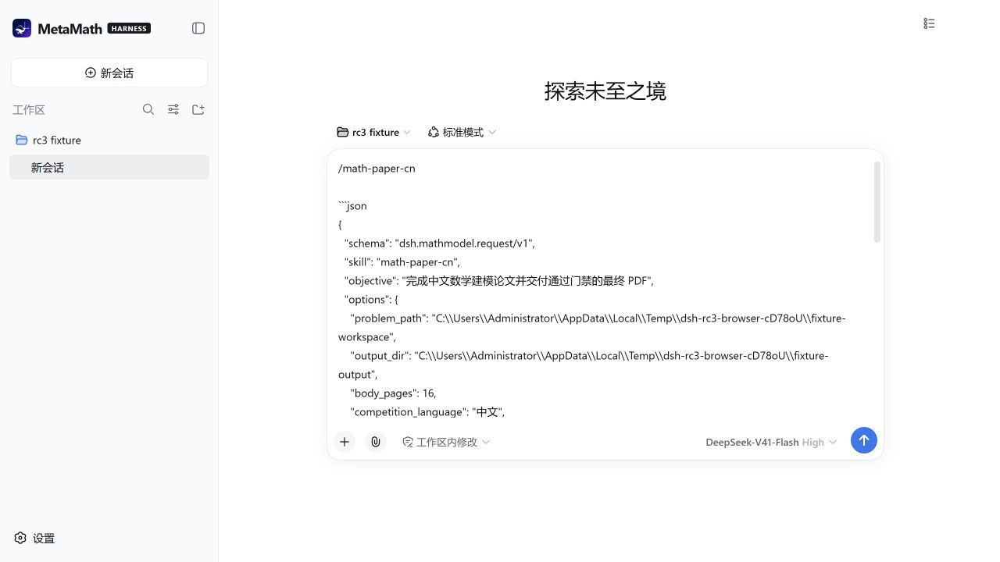

# 测试夹具与 rc.3 适配记录

2026-10-04：按用户选择分离环境集成测试，保留历史断言，暂不新增 mathmodel、imagegen、editable-ppt 预设功能。

## 修改计划

1. 已复现原始基线：159 项，120 通过、38 失败、1 跳过。
2. 默认测试只依赖受版本控制的插件源码和临时夹具；真实技能、官方运行时、个人预设和订阅补丁分别由显式集成命令验证。
3. 环境路径复用桌面壳的 DSH_HOME 解析，默认使用 `~/.dsh-mathmodel`，支持显式覆盖。缺失的历史预设保留检查并明确标为缺失；不编造产物。
4. 品牌快照先核对 Git 源码，再修复 CRLF/LF 导致的哈希差异，保留原期望值。
5. 对实际 rc.3 运行时补充 Remote、Slot、Input Trigger、Conversation、Preset 回归，记录自动化与浏览器验证的边界，再同步版本文档。
6. 分别运行默认测试、真实技能测试、运行时检查、历史预设检查、桌面壳测试及源码语法检查，记录实测结果。

## 已完成的修改

- 默认测试保留纯行为和可复现夹具。真实技能、官方运行时、部署 profile、历史契约与 PPT 模拟端到端测试分别由显式命令运行；原内容断言保留在对应环境套件中。
- 环境路径复用桌面壳解析：默认 `DSH_HOME=~/.dsh-mathmodel`、`DSH_PROFILE=mathmodel`。支持 `DSH_SKILL_ROOT`、`DSH_TEST_PROFILE_ROOT`、`DSH_TEST_RUNTIME_ROOT`、`DSH_AGENT_PRESETS_ROOT`；显式运行时路径错误不会回退到另一份内核。
- 品牌源码与 Git 中内容一致，原失败仅由 CRLF/LF 引起；哈希输入规范为 LF，原期望 SHA256 不变。现有图标复制到受版本控制的 `src/assets/MetaMath-Harness.ico`，插件构建与 Windows 打包均从此读取。
- Draw.io 预检增加 `%LOCALAPPDATA%/Programs/draw.io/draw.io.exe`，覆盖 Windows 用户安装位置；回归测试先复现失败，再验证修复。
- rc.3 的版本门与可选 peer 白名单一致，继续拒绝未列入白名单的内核。未执行 0.2.0 升级。

## 标准预设启动缺陷与修复

真实浏览器创建 `standard` 会话曾报 `deployment:persona-prefix already registered`。host 与 profile 顶层存在 27 个同名同版本的官方模块实体；`dsh-scope` 使用模块私有 Symbol 标记作用域，两份实体无法识别对方创建的 scope，导致 profile 的 prompt 注册落到全局层。

桌面启动新增 `ensureFrameworkCohort`：仅处理带本应用播种标记的 profile，先检查全部同名官方包的名称和版本，再把原 profile 包移到 profile 内的备份目录，建立到 host 实体的链接。官方 JavaScript 与构建暂存中的官方包保持原样，安装包不因此包含链接。

版本冲突、损坏标记和越界目录在迁移前明确报错；任一转换失败会逆序恢复整批已移动包。测试注入第二个包的链接失败，证明第一和第二个包都恢复。播种标记纳入修订号、构建时间与运行时绝对路径，重建或搬动安装目录时使用已有 reseed 流程，保留用户 patch。播种复制和删除前也拒绝外部 profile/profiles junction，并验证其外部文件未被修改。无播种标记的用户自管 profile 不会被转换。

备份目录为 `<profile>/.dsh-framework-cohort-backup-*`，实际位置写入桌面启动日志。本次保留备份以供恢复，不自动清理；多次重建可能增加磁盘占用。原有外部技能 junction 不在转换范围内。

## 验证结果

| 目录 / 命令 | 2026-10-04 实测 |
| --- | --- |
| 仓库根 `npm test` | 35/35 通过，含模块身份、整批回滚、路径校验、外部链接、真实 Electron 播种迁移、分发配置与载荷过滤回归 |
| 插件 `npm test` | 134/134 通过，0 跳过；不依赖个人技能或预设 |
| 插件 `npm run check` | 源码语法检查通过 |
| 插件 `npm run test:environment` | 官方运行时/profile 5/5、实际技能 28/28、当前机器依赖预检 1/1 通过 |
| 插件 `npm run test:e2e:editable-ppt` | 1/1 通过；真实技能 CLI 源码、假供应商，覆盖单页、双页并发、页内串行、metadata 登记与零秘密扫描 |
| 插件 `npm run test:legacy` | 8 项断言保留并明确失败，见下文；未计入默认测试通过数 |
| `git diff --check` | 通过 |

PPT 测试默认通过 Python 执行技能目录中的 `cli/editppt/cli.py`，可用 `EDITPPT_EXE` 指定已安装 CLI。没有安装新依赖，也没有调用付费供应商。论文 E2E 的环境路径已修正并做导入检查，本轮没有执行完整论文生产链路。

### 实际 rc.3 浏览器回归

使用仓库暂存的 `@deepseek-ai/dsh@0.1.5-rc.3`、Node 24、全新临时 `DSH_HOME`、本插件构建产物与只读实际技能目录。隔离 profile 只启用官方 `dsh-base`、`dsh-web-app` 和本插件；不启用第三方全家桶、遥测与 hooks，不填写 API Key。

| 接口 | 实测结果 |
| --- | --- |
| Remote | 插件挂载成功；技能说明返回实际目录，卡片 render 返回结构化草稿，预检显示环境就绪 |
| Slot | 卡片在 conversation overlay 挂载；入口夹具另外检查全部五个 Slot 的注册与服务读取顺序 |
| Input Trigger | 输入 `/math-paper-cn` 返回实际 Skill 候选，选择后打开对应卡片；预设切回后重新读取目录 |
| Conversation | 卡片打开时输入被阻断；取消恢复原草稿；确认通过 CAS 写入草稿，未发送消息；CAS 冲突与连接重置由可观测夹具覆盖 |
| Preset | 标准会话成功创建；标准 → 极简 → 标准切换成功，草稿保留，无 Persona 重复注册 |

最终浏览器警告/错误日志为空。截图记录标准预设和已写入的草稿：

上述首轮浏览器验证覆盖这些接线，使用的是最小 Profile。后续完整 Profile、Windows 解包 EXE 与分发产物的结果另见 [Windows 分发验证](windows-rc3-verification.md)。付费模型与论文交付流程没有实测。测试 host 与浏览器 tab 在验证后关闭。

## 保留的历史缺口

`test:legacy` 的 8 项失败具体为：mathmodel 预设的组合与 Persona（2）、imagegen 预设（1）、editable-ppt 预设 Persona 与 roster（2）、`dsh-subscription@0.6.0` 补丁（1）、旧版 Vision 独占 `vision_analyze` 文案（1）和个人 `.env` 存在断言（1）。这些材料没有恢复来源；本轮没有新增预设、修改订阅包或制造 `.env` 来让断言通过。

当前 Claude Vision 技能的原生工具优先、条件性 `vision_analyze` 与安全边界由实际技能套件另行验证。旧断言仍在历史套件中，保留与当前契约的差异。

本次只修改项目源码、测试、文档及仓库内本插件暂存产物；没有修改用户凭据、会话、个人 profile 或已安装应用，没有提交无关文件。
